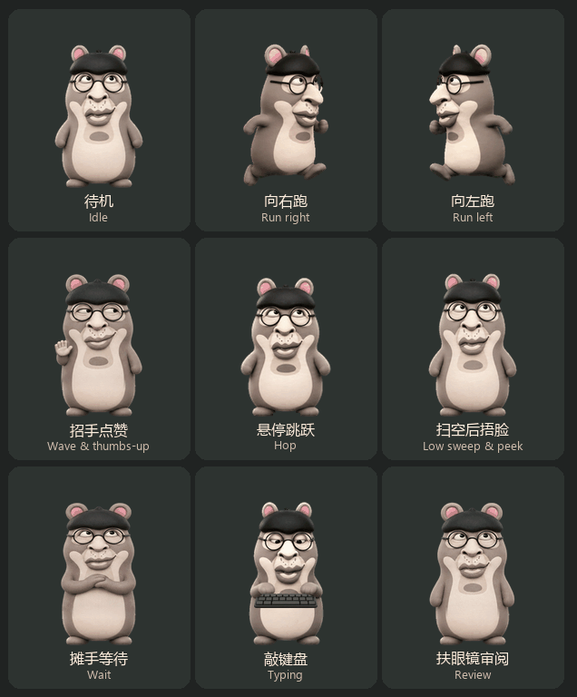

# 大飞鼠 · Faker Flying Squirrel for Codex

一只可以装进 **Codex 桌面应用**的 Faker 梗图桌宠。圆眼镜、黑刘海和憋不住的笑都来自「大飞鼠 / 飞天鼠」的同人形象。动作版保留原有体型，给它加了招手点赞、捂脸偷看、摊手等确认、敲键盘和扶眼镜审阅。

An animated **Codex desktop pet** inspired by the **Faker Flying Squirrel** and **Faker Flying Mouse** memes. See it wave and give a thumbs-up, peek after a facepalm, shrug while it waits, tap a tiny keyboard, and adjust its glasses during review.

[**下载 Windows 安装包 · Download for Windows**](https://github.com/99Like-wjj/codex-pet-faker-flying-squirrel/releases/latest/download/faker-flying-squirrel-codex-windows.zip) · [版本记录 · Releases](https://github.com/99Like-wjj/codex-pet-faker-flying-squirrel/releases)

播放九种状态 · Watch all nine animations

## 安装到 Codex（Windows）

1. 下载上方 ZIP 并解压。
2. 在文件资源管理器地址栏输入 `%USERPROFILE%\.codex\pets`。如果设置过 `CODEX_HOME`，打开该目录下的 `pets`。目录还没创建时，先建一个。
3. 把解压得到的整个 `faker-flying-squirrel-motion` 文件夹复制进去。打开该文件夹就能看到 `pet.json` 和 `spritesheet.webp`。
4. 在 Codex 桌面应用的宠物选择器里选 **大飞鼠 · 动作版**。列表还没刷新时，重启 Codex 后再打开。

## Install in Codex on Windows

1. Download and extract the Windows ZIP above.
2. Open `%USERPROFILE%\.codex\pets` in File Explorer. If you set `CODEX_HOME`, open its `pets` folder instead. Create the folder if needed.
3. Copy the entire `faker-flying-squirrel-motion` folder into `pets`. Its two files, `pet.json` and `spritesheet.webp`, should be directly inside it.
4. Open the pet picker in the Codex desktop app and select **大飞鼠 · 动作版**. Restart Codex if the new pet does not appear.

## 动作 · Animations

| 状态 | 动作 | Animation |
| --- | --- | --- |
| 待机 | 眨眼、憋笑 | Blink and smirk |
| 左右走动 | 侧身小跑 | Run left or right |
| 招手 | 挥爪后竖拇指 | Wave and give a thumbs-up |
| 跳跃 | 起跳、腾空、落地 | Hop and land |
| 失误 | 捂脸后从手后偷看 | Facepalm and peek |
| 等待 | 合手等一会儿，再摊开手 | Clasp paws, then shrug |
| 工作 | 左右爪交替敲小键盘 | Type with alternating paws |
| 审阅 | 眯眼扶镜框 | Squint and adjust glasses |

动作随 Codex 的内置桌宠状态播放。透明 WebP 图集为 1536 × 1872，每帧 192 × 208，包含 57 个有效帧。The animations use Codex’s built-in pet states and its local sprite atlas format. [Codex pet format](https://github.com/openai/skills/blob/main/skills/.curated/hatch-pet/references/codex-pet-contract.md)

## 角色来源 · About the meme

大飞鼠也叫飞天鼠或飞大鼠，常见于围绕 **Faker（李相赫、이상혁、페이커）** 的同人表情包。Faker, also known as **Lee Sang-hyeok**, is the League of Legends (LoL / 英雄联盟) player associated with T1 and its former name SKT T1. 这是独立制作的同人作品。This Codex pet is an independent fan creation. [大飞鼠表情包参考](https://pdan.com.cn/13654.html) · [T1](https://www.t1.gg/news)
