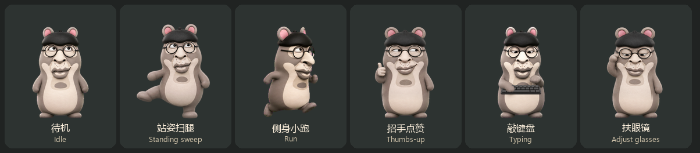

# 飞飞鼠 · Feifeishu for Codex

飞飞鼠是可以装进 **Codex 桌面应用**的 Faker 梗图桌宠，也叫大飞鼠、飞天鼠。它戴着圆眼镜，站着就抬腿横扫出去，扫空了才捂脸偷看。

**Feifeishu** is an animated **Codex desktop pet** inspired by the **Faker Flying Squirrel** and **Faker Flying Mouse** memes. When a task fails, it sweeps one raised foot sideways from a standing pose, misses, and peeks out from behind its paws. It also waves, types with alternating paws, and adjusts its glasses during review.

[**下载 Windows 安装包 · Download for Windows**](https://github.com/99Like-wjj/feifeishu-codex-pet/releases/latest/download/feifeishu-codex-pet-windows.zip) · [版本记录 · Releases](https://github.com/99Like-wjj/feifeishu-codex-pet/releases)

## 站姿扫腿 · Standing sweep

**任务失败时**，飞飞鼠从站姿直接抬起一条腿，扫过身前。支撑脚着地，扫动脚抬到下腹附近，肩和髋随动作转过去。扫空后收脚站稳，再捂脸偷看。镜头沿用桌宠的固定正面视角。**鼠标悬停**时播放普通跳跃。

The standing sweep plays in the desktop pet’s **failed task** animation. It lifts one foot to the height of its lower belly and sweeps it across the front while its body turns. The front camera stays fixed. Hover over the floating pet to see its regular hop.

扫腿借鉴了视频中的摆身、抬脚和快速收腿。[飞飞鼠与马头羊（再补档）](https://www.bilibili.com/video/BV1Gj476zEQL/)

播放九种状态 · Watch all nine animations

## 安装到 Codex（Windows）

1. 下载上方 ZIP 并解压。
2. 在文件资源管理器地址栏输入 `%USERPROFILE%\.codex\pets`。如果设置过 `CODEX_HOME`，打开该目录下的 `pets`。目录还没创建时，先建一个。
3. 把解压得到的整个 `faker-flying-squirrel-motion` 文件夹复制进去。打开该文件夹就能看到 `pet.json` 和 `spritesheet.webp`。
4. 在 Codex 桌面应用的宠物选择器里选 **飞飞鼠**。列表还没刷新时，重启 Codex 后再打开。

## Install in Codex on Windows

1. Download and extract the Windows ZIP above.
2. Open `%USERPROFILE%\.codex\pets` in File Explorer. If you set `CODEX_HOME`, open its `pets` folder instead. Create the folder if needed.
3. Copy the entire `faker-flying-squirrel-motion` folder into `pets`. Its two files, `pet.json` and `spritesheet.webp`, should be directly inside it.
4. Open the pet picker in the Codex desktop app and select **飞飞鼠**. Restart Codex if the pet does not appear.

## 动作 · Animations

| 状态 | 动作 | Animation |
| --- | --- | --- |
| 待机 | 眨眼、憋笑 | Blink and smirk |
| 左右走动 | 侧身小跑 | Run left or right |
| 招手 | 挥爪后竖拇指 | Wave and give a thumbs-up |
| 悬停跳跃 | 起跳、腾空、落地 | Hop and land |
| 任务失败 | 站姿抬腿横扫，收脚后捂脸偷看 | Standing sweep, facepalm, and peek |
| 等待 | 合手等一会儿，再摊开手 | Clasp paws, then shrug |
| 工作 | 左右爪交替敲小键盘 | Type with alternating paws |
| 审阅 | 眯眼扶镜框 | Squint and adjust glasses |

动作随 Codex 的内置桌宠状态播放。透明 WebP 图集为 1536 × 1872，每帧 192 × 208，包含 57 个有效帧。The animations use Codex’s built-in pet states and its local sprite atlas format. [Codex pet format](https://github.com/openai/skills/blob/main/skills/.curated/hatch-pet/references/codex-pet-contract.md)

## 角色来源 · About the meme

飞飞鼠、大飞鼠、飞天鼠和飞大鼠都是围绕 **Faker（李相赫、이상혁、페이커）** 的同人表情包里常见的名字。Faker, also known as **Lee Sang-hyeok**, is the League of Legends (LoL / 英雄联盟) player associated with T1 and its former name SKT T1. 这是独立制作的同人作品。This Codex pet is an independent fan creation. [大飞鼠表情包参考](https://pdan.com.cn/13654.html) · [T1](https://www.t1.gg/news)
